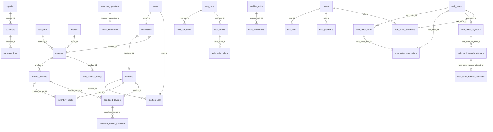

# Database and data integrity audit

Audit date: 2026-11-02. Source of structure: current migrations under `database/migrations`, checked against read-only `information_schema` and `migrations` queries on the configured MariaDB `nalaka_mobile` database. No migration or DML was run. The latest applied migration is `2026_11_02_000007_add_web_order_private_inventory_snapshots`. The diagram below shows selected **actual declared foreign keys**, not every table or an inferred business relation.

## Current schema and working-data snapshot

| Domain | Tables / exact source | Key constraints and observations |
|---|---|---|
| Identity | `users`, `businesses`, `locations`, `location_user`, Spatie role/permission tables; `create_businesses_table`, `create_locations_table`, `create_location_user_table` | `businesses.owner_id` unique FK; `setup_key` unique and used as `initial`; pivot has only location/user FKs, not business ID. One business currently. |
| Catalog | `categories`, `brands`, `products`, `product_variants`, `bundle_components`, `web_product_listings`; catalog and publication migrations | Product category/brand and variant/product references use composite business-scoped FKs; SKU/barcode scoped unique. 20 products, 6 published listing rows currently. |
| Inventory | `inventory_operations`, `inventory_operation_lines`, `inventory_stocks`, `stock_movements`, `serialized_devices`, `serialized_device_identifiers`, `serialized_device_events`, `reorder_levels`; `2026_10_15_195223_create_inventory_foundation_tables.php` | One stock row per location/variant; signed movement delta and before/after; identifier unique by business; composite business FKs on major inventory edges. 52 stock rows, 72 devices. |
| Purchasing | `suppliers`, `purchases`, lines, devices, payments, returns; `2026_10_16_025108_create_suppliers_and_purchases_tables.php` | Business-scoped invoice and operation keys; line snapshots and device identities; 1 purchase. |
| POS and cash | `sales`, `sale_lines`, components, payments, additions, returns/refunds; `cashier_shifts`, `cash_movements`, `shift_events`; sales/shift migrations | Sales and payments use business-scoped operation keys; monetary columns mainly decimal(14,2), some web totals decimal(16,2); 5 sales. Shift location/cashier have individual FKs, with business consistency enforced in service rather than composite FK. |
| Ecommerce | carts/items, quotes/items, delivery areas/mappings, pickup locations, offers/items, orders/items/payments/reservations/history, bank attempts/decisions/confirmations, fulfillment checks/fulfillments; `2026_11_01_*`, `2026_11_02_*` | Composite order/item/location/business FKs in core order and reservation tables; MySQL CHECKs for reservation quantity/device state and some money fields. Zero working web orders/reservations, so no real financial/stock trail to reconcile. |
| Audit | `product_activity_logs`, `shift_events`, `stock_movements`, `serialized_device_events`, `web_order_status_histories`; activity migrations | Domain histories exist. `2026_10_31_000004_remove_reports_and_audit_logs.php` drops generic `activity_logs`; there is no broad immutable actor-action audit ledger. |

MariaDB metadata confirms the inventory, POS and Ecommerce tables and their foreign keys. It also confirms checks including `web_reservations_positive_qty`, `web_reservations_active_device_check`, `sales_web_source_check`, `sale_payment_cod_origin_check`, `sale_payment_bank_origin_check`, and `web_fulfillment_mode_check`. These checks are MySQL-specific migration statements, so SQLite alone cannot validate them.

Composite business scoping applies to many of the drawn links; the diagram is a readable subset. For example, `web_order_reservations` uses `(web_order_item_id, web_order_id, business_id)` and `web_order_fulfillments` ties order, sale and inventory operation together. See `2026_11_01_000003_create_web_order_reservation_foundation.php` and `2026_11_02_000004_add_web_sale_bridge_foundation.php` for exact columns.

## Integrity strengths

- `InventoryService::changeQuantity` inserts/locks the location-variant balance, rejects negative results, checks active reservation floors and records a `StockMovement` with before/after values. `WebReservationService` locks relevant orders, stocks and devices and holds an `active_device_id` unique slot.
- `serialized_device_identifiers` has unique `(business_id, identifier)`, covering primary and secondary identifiers across devices. `serialized_devices` also scopes serial numbers by business. The current duplicate-identifier aggregate returned zero groups.
- Sale, purchase, inventory operation and web submission paths use unique operation/idempotency keys and database transactions. `WebOrderFulfillmentService::collectPickup` enforces a unique web-order-to-sale link plus a unique fulfillment row and posts the exact accepted allocation in the same transaction.
- Sale, purchase, quote, offer and order line tables preserve name, price, cost or device-condition snapshots rather than requiring live catalog rows for every historical display. Core historical rows use `restrictOnDelete` for many parent relationships.
- Current read-only probes found zero negative `inventory_stocks.quantity_on_hand` rows and zero active reservations with a missing order. These checks are limited because there are no working reservations or web orders.

## Risks and review items

| Priority | Evidence | Risk and validation required |
|---|---|---|
| High | `web_orders.payment_status`, `web_order_payments.status`, `web_bank_transfer_decisions`, `sales.paid_total`, `sale_payments` duplicate aspects of payment state | State transitions can drift if any path bypasses the services. Build read-only reconciliation queries and compare every non-test order to its sale/payment ledger before enablement. No live web rows exist today. |
| High | `StorefrontOrderSubmissionService` reserves stock; `WebReservationService::consumeReadyForHandover` and `InventoryService::postExactWebSale` consume it; scheduled `WebOrderExpiryProcessor` can release it | Test order expiry versus payment review, preparation, transfer, POS sale and handover in parallel on MySQL. The separate unique device slot protects IMEIs, but quantity races need transactional proof. |
| Medium | `location_user` pivot has no `business_id`; `cashier_shifts.location_id` and `cashier_id` are separate FKs | Single-business assumption is not a schema-level multi-tenant invariant. Reassess before adding independent businesses; do not assume current service scoping alone covers every future path. |
| Medium | `inventory_stocks.quantity_on_hand` and movement/event ledgers are redundant representations | Add periodic reconciliation: opening + deltas = on-hand by business/location/variant; count in-stock serialized devices versus relevant event history and sale/return state. No complete ledger audit was performed here. |
| Medium | Quantity `decimal(14,3)`, catalog price `decimal(12,2)`, sale `decimal(14,2)`, web order `decimal(16,2)` | Precision is generally explicit but not uniform. `WebOrderFulfillmentService::assertMoneyFitsSale` guards bridge overflow; verify maximum-price assumptions and rounding with real business policy. |
| Medium | `web_order_items` permits nullable catalog references and retains snapshots; cart item FKs cascade on product/variant delete | Historical order display is protected; deletion can remove abandoned cart items. Confirm retention and deletion policy. Treat snapshots as immutable after acceptance. |
| Medium | Generic `activity_logs` is dropped by `2026_10_31_000004_remove_reports_and_audit_logs.php`; domain-specific histories remain | Product, stock, shift and web-order activity exists, but broad security/admin auditability is incomplete. Define required actor, before/after and retention evidence. |
| Medium | `WebBankTransferService::submit` writes proof file before DB transaction and deletes new file on failure/replay; proof path on private disk | Crash between file write and transaction can orphan a file. Add a periodic orphan scan and retention policy after choosing storage/backup semantics. |

## Reconciliation and acceptance queries for a later implementation phase

Do not run these against working data as mutations. Use read-only SQL or a copy to compare: stock balance versus movement deltas; duplicate IMEIs across both slots; device status/location versus latest device event; active reservations versus physical free stock; web order total versus offer and item sum; web payment status versus bank decisions and sale payment; web fulfillment's order/sale/inventory operation identity; sale paid/refund totals versus payment and refund rows; cashier expected cash versus cash sale payments, refunds and cash movements. Capture discrepancy counts and investigate each nonzero result before rewriting data.

The audit did not perform a full table-by-table data quality scan, restore test, transaction rollback test or payment reconciliation. Those are explicit roadmap gates, not assumed passes.
