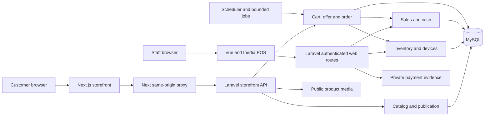
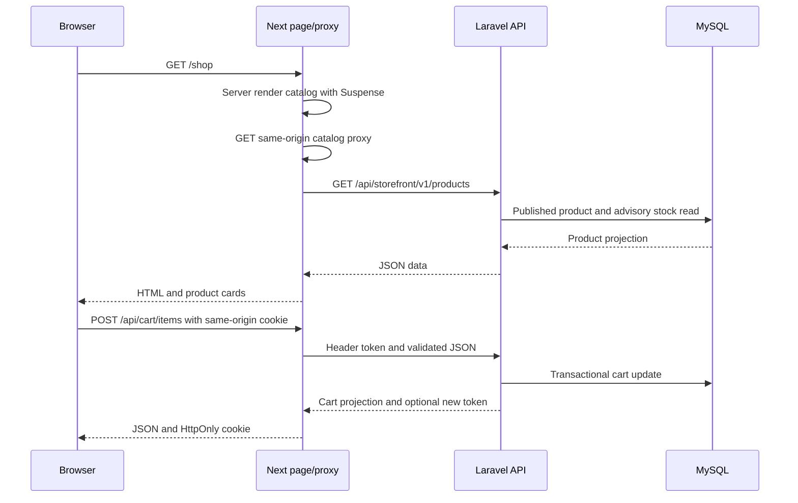
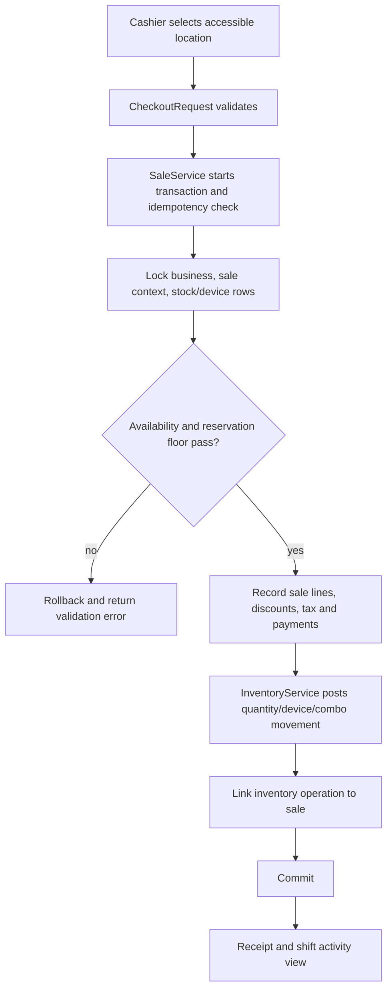
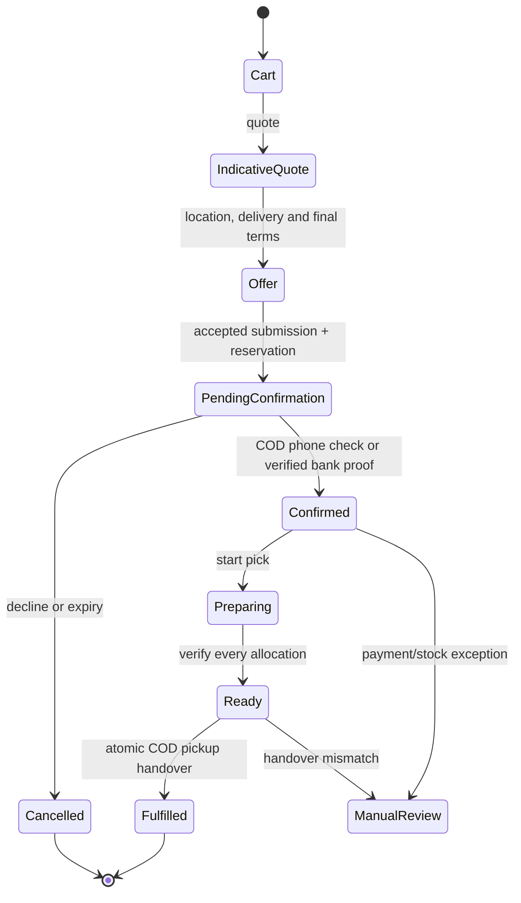
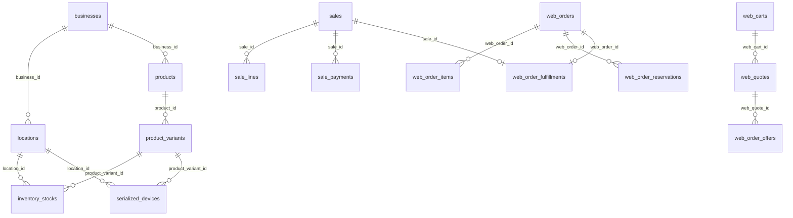

# Proposed NalakaMobile target architecture

This is a **future design proposal**, not an implementation plan already executed. It keeps Laravel 13, Vue 3/Inertia, MySQL/MariaDB and Next.js 16. The [full audit](full-system-technical-audit.md) and [actual database relationships](database-and-data-integrity-audit.md) supply the source evidence. Avoid a full rewrite while existing inventory, IMEI, sales and purchase history has not been completely reconciled.

## Ownership and boundaries

| Boundary | Proposed owner | Rule |
|---|---|---|
| Products, variants, prices, publication | Laravel catalog module | POS changes authoritative values; web copy/publication is explicitly approved and versioned. Next does not compute a price. |
| Stock, devices, locations, reservations | Laravel inventory module | One transactional stock authority; all sale, return, transfer, repair-part and web handover paths use it. Query projections may be cached briefly but writes recheck under lock. |
| POS sale and money | Laravel sales/accounting module | Immutable sale/payment/refund evidence, idempotent commands, explicit paid/credit status and drawer posting. Web handover calls this domain, not a parallel calculator. |
| Customer order | Laravel order module | Offer, accepted terms, reservation, staff decision, payment evidence, preparation and fulfillment state machine. Every transition records actor and reason. |
| Staff UI | Laravel Inertia + Vue | Authenticated administrative/transaction screens with permission and location checks on server. |
| Customer UI | Next.js | SEO/catalog rendering, cart/checkout/tracking interactions, same-origin browser proxy, HttpOnly guest credentials. No inventory or accounting authority. |
| Files | Public product image store; private payment evidence store | Explicit retention, backup and malware/content handling; serve private files only through authorized Laravel endpoints. |

### Proposed system architecture

This reflects the current application split and proposes clearer internal Laravel module ownership. A separate microservice or extra database is not justified by the current one-business scale.

### Main customer request flow

The same-origin server self-fetch in `Ecommerce/lib/storefront-api.ts` is current behavior. A later optimization can call Laravel directly from server components while retaining browser proxies; preserve error mapping and public image origin separation.

### POS sale and inventory flow

This diagram represents source-level current transaction intent in `SaleService` and `InventoryService`; the proposed change is to make the command boundary and rollback/reconciliation tests explicit. Repair-part consumption should use the same inventory owner, with a repair-job reference, in a later module.

### Ecommerce order lifecycle

The COD pickup path is implemented in source. The proposed future lifecycle must add an approved bank-transfer/home-delivery fulfillment and accounting path before that branch can reach `Fulfilled`. Do not silently label it complete today.

### Key existing database relationships

All diagram edges above have declared foreign keys in the inspected migrations. This is a subset for the architecture view; the complete evidence and qualified ERD are in the database audit.

## Application design standards for the next phase

1. Preserve the existing MySQL schema and data initially. Add migrations only after backup, dry run and read-only reconciliation. Do not change historic sale or device identity semantics merely to simplify code.
2. Break large services by use case (`receive`, `transfer`, `adjust`, `post sale`, `return`, `reserve`, `consume`) behind a small transactional facade. Retain one deterministic lock order: business, order/sale, stock or device, reservation, payment. Prove with concurrency tests before changing production paths.
3. Define versioned command and response contracts for catalog, cart, offer, submission, tracking and proof. Laravel remains authoritative for validation and money; Next uses generated or shared schema fixtures for compile/runtime checks. Keep safe error codes and request IDs.
4. Authorization remains server-enforced: named permissions, scoped route binding, business/location checks, sensitive cost and evidence permissions. Explicitly decide whether independent businesses are supported; if so, remove `setup_key=initial` and global owner assumptions through a dedicated migration/audit project.
5. Store money as decimal strings or `BigDecimal` in business logic, with explicit rounding, immutable snapshots and append-only payment/refund events. Add reconciliation views before any ledger expansion. No accounting schema changes are authorized by this document.
6. Use queues only where they improve a real workflow: proof scanning, notification, report export or media processing. Keep reservation and handover transactions synchronous. The existing expiry scheduler needs monitoring, bounded retries and a durable cursor.
7. Keep catalog images in public object storage or a stable public disk with validated paths; keep payment proof in private storage. Add backup/restore, retention and orphan-file cleanup. Never put order credentials or internal API URLs in browser-visible payloads.
8. Treat `no-store` and dynamic rendering as deliberate for price/stock/order views. Cache only publication/category data with an invalidation rule. Profile the current per-variant/location stock read before optimization; keep write-time checks uncached.
9. Add structured domain logs with request/order/operation IDs, redaction for contact and proof data, alerting for expiry failures, reservation mismatches, payment exceptions and reconciliation drift.

## Deployment shape

Use a PHP app worker/web server for Inertia and Laravel API, a separate Next runtime for the storefront, one MySQL instance, private proof storage, public media storage, scheduler and centralized logs. Configure `STOREFRONT_API_URL` as server-only, `STOREFRONT_SITE_ORIGIN` as the actual HTTPS Next origin, and a public approved image origin. Validate storage links or object-store URLs, HTTPS cookies, reverse-proxy headers, queue/scheduler execution, backups and restore. Build Next on a host where its CSS worker can bind the required local port; the audit environment's port error is an infrastructure constraint until independently reproduced on deployment CI.

## Decision options

| Option | Cost/risk assessment | Recommendation |
|---|---|---|
| Continue current stack and patch only | Lowest immediate cost, but giant services and incomplete accounting/repair/order operations remain | Use only for short stabilization |
| Refactor selected modules on current stack | Moderate effort; protects existing data/behavior with golden-master tests; addresses real maintainability and missing workflows | Preferred |
| Full rewrite | Highest schedule, migration and silent financial/IMEI regression risk; current architecture has useful constraints and tests | Not justified by audited evidence |

The [roadmap](rebuild-and-refactoring-roadmap.md) defines the decision gates before implementation.
