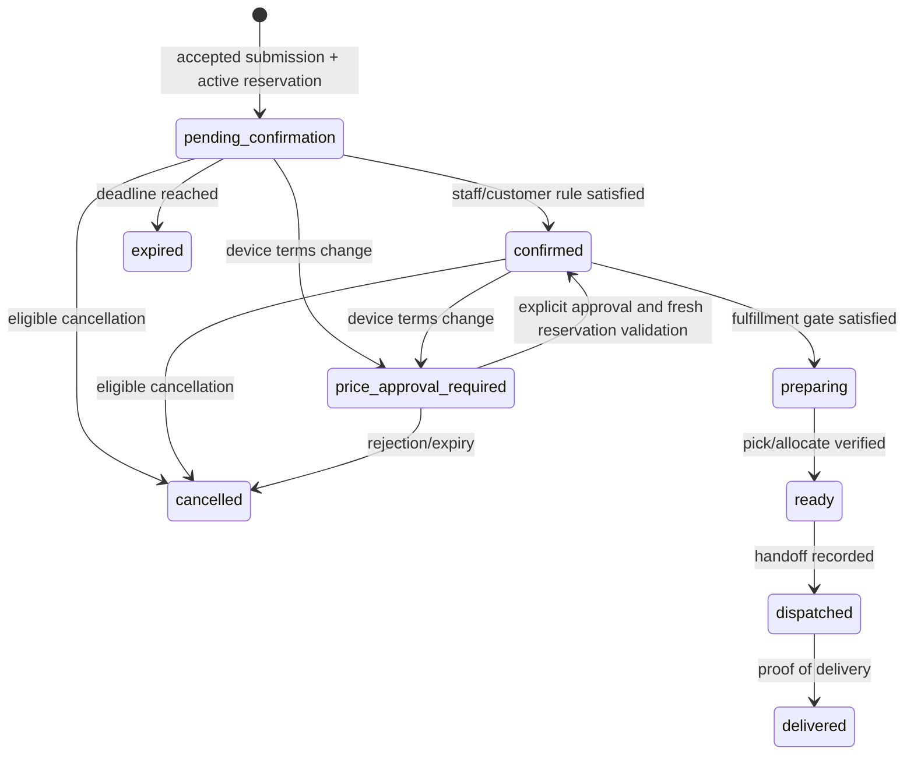
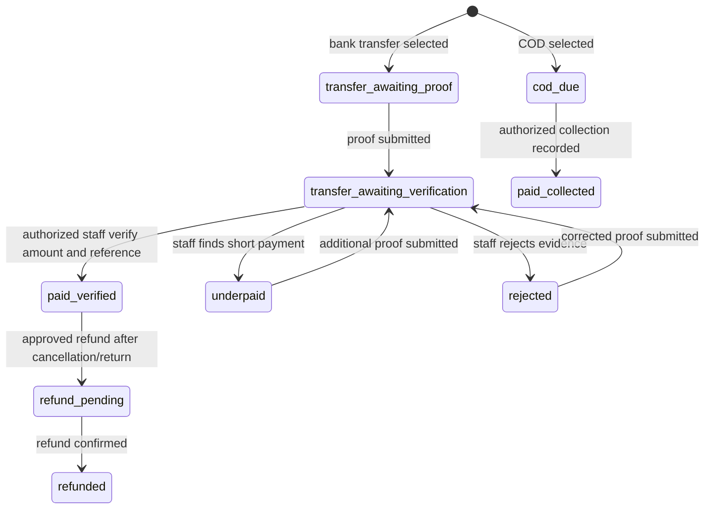
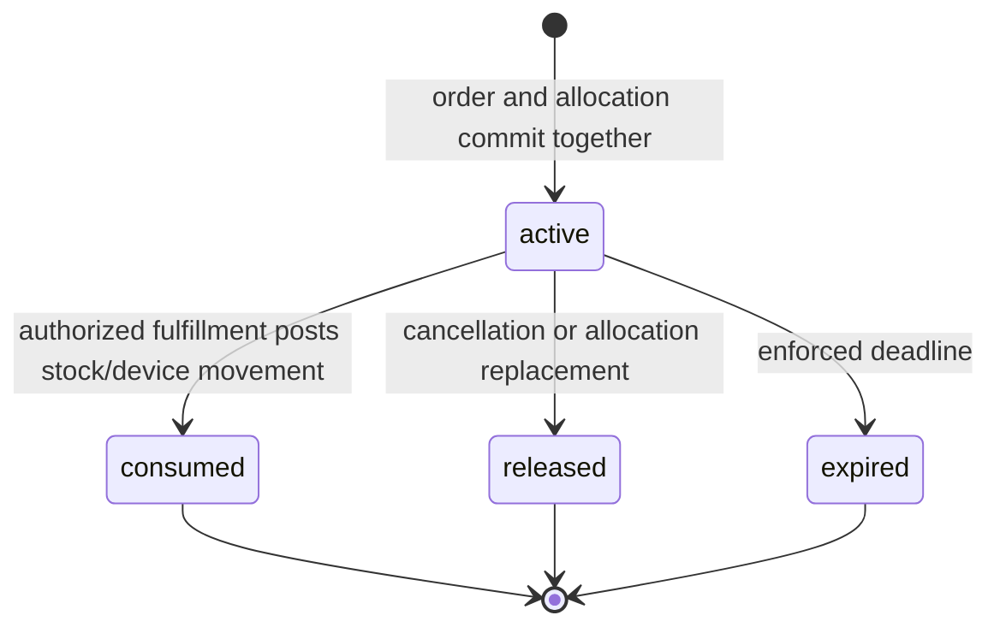

# NalakaMobile Phase 5A — order submission and atomic reservation architecture

**Status:** planning proposal, 1 November 2026. No order or reservation behavior is implemented by this document. Business defaults marked **recommended, unapproved** require a decision before implementation. Laravel remains the authority for catalog, money, inventory, orders and payment state; Next.js is the customer interface.

## 1. Current implementation and document reconciliation

The two applications are `NalakaPos/` (Laravel 13, Vue/Inertia, MySQL) and `Ecommerce/` (Next.js 16, React 19). The active Laravel public routes in `routes/api.php` serve the catalog, guest cart and quotes. `web_product_listings` controls publication. `StorefrontCartService` persists `web_carts`/`web_cart_items`, checks current publication and advisory location availability, and writes `web_quotes`/`web_quote_items`. A quote is valid for 15 minutes, has a ULID reference, and explicitly returns `total_is_final: false`, `delivery_included: false` and `inventory_reserved: false`. The cart cookie is owned by the Next.js route handlers; Laravel stores only a SHA-256 cart-token hash. `Ecommerce/app/checkout/page.tsx` remains unavailable. There are no web order, delivery-area, payment or reservation tables or endpoints in the inspected implementation.

`StockAvailabilityService::query` derives quantity availability from `inventory_stocks`, serialized availability from `serialized_devices` with `status=in_stock`, and combo capacity from component stock. It currently does **not** subtract web reservations. `StorefrontCatalogService::startingPrice` chooses the minimum eligible used-device selling price across active locations, so that price may differ from the device at the delivery-eligible fulfillment location. `StorefrontCartService::quote` requires a common currently stocked location but does not account for a delivery area or aggregate shared component demand; it rejects overlapping component variants as uncertain. This is an advisory quote, not an order-ready offer.

`SaleService::checkout` creates a completed POS sale and posts inventory in a database transaction with retry count 3. It locks the business row; `InventoryService::postSale` shares that transaction, locks the sale, and writes quantity or serialized movements. `InventoryService::changeQuantity` locks the physical stock row but currently checks only that stock will not go negative. `InventoryService::markDeviceSold` checks status and location but not reservation ownership. Combo consumption calls `resolveBundleAvailability`, then decrements quantity components or locks and sells serialized components. `InventoryService::transfer` can move quantity or devices, and `changeDeviceStatus` can make a device unavailable; neither currently checks web reservations. Thus a future UI-only availability change would not protect reserved stock. Web orders must remain separate from completed POS `sales`.

The Phase 1 document is historical: its statements that no API or `web_*` tables exist and that Ecommerce is demo-only are now outdated. It correctly calls for separate orders, payment state, one location, Laravel-owned delivery fees and transactional POS enforcement. Its sentence suggesting a used device can be **reserved before** customer agreement conflicts with the current requirement to reserve the exact device **after** explicit price/condition acceptance. This proposal resolves that by using an expiring, non-binding device offer before acceptance and a committed reservation only in the accepted order transaction. Phase 4 deliberately excludes delivery fees and device-specific totals; Phase 1 expects them in a final quote. The existing Phase 4 quote therefore cannot be submitted directly. A new order-ready offer/quote revision must include delivery area, selected location, exact device terms and final total, and must be checked again on submission.

## 2. Invariants and transaction ownership

1. Each accepted web order has exactly one fulfillment location. Every physical reservation is at that location; no initial split fulfillment.
2. The same underlying stock pool serves standalone products and combo components. Reserving a combo reserves its **components**, not an imaginary combo stock row.
3. Physical inventory and device status stay unchanged at reservation time. Sellable quantity is physical on-hand minus active reserved demand. A serialized device can have at most one active reservation.
4. Price, delivery fee, published status, location and inventory are recalculated by Laravel. Browser totals, location IDs, device IDs and stock counts are never authoritative.
5. An order and all of its reservation rows commit or roll back together. A payment proof is neither payment verification nor a POS sale.
6. An accepted order is an immutable record of customer-agreed terms. Later changes create revisions/approval events; they never silently overwrite accepted prices, condition or total.
7. Every inventory-decreasing path, including POS checkout and transfers, enforces reservation floors **inside its own transaction**. Catalog and UI availability are advisory.

## 3. Proposed schema, relationships and constraints

These are designs to validate against current migrations before writing migrations. All new operational rows have `business_id`; composite `(id,business_id)` keys and scoped foreign keys should be used where the referenced tables support them. Do not cascade-delete historical orders. Preserve snapshots even if catalog records are later retired. Use `DECIMAL(16,2)` for money and the existing three-decimal inventory scale for component demand; use decimal-safe arithmetic (`Brick\Math\BigDecimal`, already used by the cart service).

| Entity | Required fields and relationships | Constraints and notes |
| --- | --- | --- |
| `web_orders` | Business, public ULID reference, source `web_quote_id` and `web_cart_id`, optional future web account/POS customer links, one `location_id`, `delivery_area_id`, guest owner token hash, order state, payment method, separate payment summary or payment relation, accepted currency/subtotal/discount/delivery/total, delivery-address and contact snapshots, quote/offer version, submission payload hash, submitted/confirmation/reservation expiry timestamps. | Unique public reference and `(business_id, submission_key)`; key is scoped to the guest cart/account principal. Reference is not a secret. Order FK to quote/cart should restrict deletion. Keep old contact and amounts even when profiles/catalog change. No `sale_id` until a deliberate fulfillment conversion design exists. |
| `web_order_items` | Business/order FK, nullable historical product and variant FKs, public name/slug/variant/condition/specification snapshots, quantity, unit/line price, agreed used-device condition summary and approval version. | Unique line ordinal per order. Device ID stays private in reservation/allocation, not public order resource. Snapshot only accepted terms, not a copy of live catalog. Prevent mutable totals after acceptance. |
| `web_order_status_histories` | Business/order FK, from/to order state, actor type/id (staff or system/customer), reason code, safe customer-facing message, timestamp. | Append only; separate staff-only audit details if necessary. Indexed by order/time. Store who caused cancellation, expiry, confirmation and fulfillment transitions. Payment verification receives its own audit event. |
| `web_order_reservations` | Business/order/order-item/location FKs, **underlying component variant** FK, quantity, optional private serialized-device FK, `active/consumed/released/expired` status, expiry and transition timestamps. | One row per underlying quantity demand or per exact device. For combo rows, retain source combo order-item FK and component variant FK. Unique `(order_item_id, reservation_line_key)` prevents duplicate allocation. For serialized rows, `active_device_id` is nullable, unique, populated only while active and cleared on transition; MySQL has no ordinary partial unique index. Also lock/recheck device row. Index `(business_id,location_id,component_variant_id,status,expires_at)`. |

The active-device uniqueness pattern needs a migration-level check that `active_device_id` matches the private `serialized_device_id` for active rows and is null otherwise; enforce in service logic as well, and use a database check constraint where supported. The unique key is global on device ID because a physical device must not be actively reserved in two businesses either. For quantity rows, an active reservation query sums underlying component demand; never sum parent combo quantity separately. No duplicated product, variant, IMEI, stock balance or device table is proposed.

Supporting entities required by the complete Phase 5 flow, with timing kept explicit:

- `web_delivery_areas` and `web_location_delivery_areas`: Laravel-owned active areas, eligible locations, configurable fee and selection priority. Area identifiers are public; fee and eligibility are server read values. Exact fee schema depends on whether the fee is area-only or location-specific (open decision).
- `web_order_payments`: order payment method/amount/status and separate attempts; bank proof is private. `web_payment_verifications` records staff decisions and evidence review. These are needed when bank transfer is enabled, not for the reservation transaction itself. COD remains due until actual collection is recorded.
- An expiring **order-ready offer** or quote revision is required. It must bind cart/quote, delivery area, one location, line terms, internally selected used devices, final fee/total, expiry, ownership principal and a digest of accepted terms. Existing `web_quotes` cannot express these facts. Choose either additive `web_order_offers` and offer lines or a carefully versioned extension of `web_quotes`; prefer a separate offer to preserve Phase 4's explicit indicative semantics. Device identifiers remain private. An offer does **not** reserve inventory.
- `web_order_price_approvals` is needed if staff can propose a different used device or condition after order acceptance. A rejected/expired proposal leaves the accepted order unchanged and must lead to cancellation/release or a fresh customer-approved order revision. A single pre-order offer acceptance may be captured by the offer digest plus order event instead of a separate approval row.
- A separate `web_idempotency_keys` table is not required for the first order-create command if the order's unique submission key, principal and payload hash can be checked atomically. Use a command ledger only if retries must survive a pre-order failure with a durable result or the key spans multiple commands.
- Registered-account and saved-address tables remain future account work. Guest contact/address snapshots are mandatory now. A POS `customers` link is optional and requires verified ownership, never email/phone auto-match.

Historical retention and deletion rules must be defined before migration: restrict referenced order/quote/cart deletion while orders exist; allow nullable catalog FKs with immutable snapshots if hard deletion is supported; do not cascade order history, payment or reservation audit rows away.

## 4. Order, payment and reservation lifecycles

These names are proposed; deadlines and who may advance each state remain approvals.

`cancelled`, `expired` and `delivered` are terminal for the original accepted transaction; exceptions/returns require separate audited workflows. An order may be `awaiting_payment` as an operational view, but payment state is stored separately and must not be inferred from order state. Do not automatically mark transfer paid on proof upload.

Payment attempts and decisions are append-only; a summary status is derived or transactionally updated from them. Underpayment is never auto-accepted. If an order expires after a bank transfer occurred, staff reconciliation/refund is required; never simply discard money evidence. COD fulfillment and bank-transfer preparation/dispatch gates need approved business rules.

Expiry is enforced by both scheduled jobs and a synchronous check before availability-sensitive writes; jobs may be delayed. Under the business/order locks, an expiry operation first verifies the order's current eligibility and deadline, then transitions the order and all active reservations together. Availability sums reservations whose status is still `active`; it must **not** merely ignore rows with a past timestamp while leaving an apparently valid order alive. Release/consume is idempotent and records actor/reason/time. An expired reservation must not remain counted forever merely because a scheduler failed, but a late scheduler must not release a confirmed order. The exact expiry/extension policy requires approval. If a reservation is consumed, the associated physical decrement/device sale and state transition occur in one transaction; no double subtraction window is allowed.

## 5. Order-ready offer and API contract

All proposed customer paths are under `/api/storefront/v1`, proxied by same-origin Next.js handlers. Public responses use `{data: ...}`; errors keep the current `{error:{code,message,fields},request_id}` shape and `Cache-Control: private, no-store`. The existing 15-minute `/quotes` result stays explicitly indicative until a separately approved revision. Order APIs need request-size and per-principal/IP rate limits. Staff actions use authenticated permissioned routes, not public storefront routes.

| Method/path (proposal) | Request / result | Failure behavior |
| --- | --- | --- |
| `POST /order-offers` | Cart token from existing proxy; body has prior quote reference, delivery area, validated contact/address and payment method. Laravel recomputes full-cart location, exact used-device price/approved condition, delivery fee, subtotal and total. Returns short-lived opaque offer reference, expiry, public line terms and digest; no device ID/IMEI. | `QUOTE_EXPIRED`, `QUOTE_STALE`, `UNSUPPORTED_AREA`, `NO_SINGLE_LOCATION`, `PRICE_UNAVAILABLE`, `DEVICE_UNAVAILABLE`. No reservation. |
| `POST /orders` | `Idempotency-Key` header, offer reference, exact accepted-terms digest/explicit acceptance, validated guest details and payment method. Guest cart token is forwarded server-side. Laravel revalidates all terms and reserves in one transaction. Returns public reference, status, payment state, final snapshots, reservation expiry and a stable guest tracking secret handled only by the Next.js proxy. | `409` for changed price/condition/fee, no common location, stock conflict, or reused key with different payload; `410` for expired offer/quote; `422` for invalid input. No partial order. |
| `GET /orders/{reference}` | Guest tracking credential or authenticated owning account. Returns public-safe order/payment summary and history. | `404` or `403` without ownership; no internal IDs. |
| `POST /orders/{reference}/cancel` | Ownership credential, applicable cutoff, idempotency key. | Separate authorized transaction releases active reservations; later stage only. |
| `POST /orders/{reference}/bank-transfer-proof` | Ownership credential, validated private upload/reference. | Stores an unverified attempt only; later payment stage. |

The cart token authenticates the cart, not an order forever. Derive a stable, high-entropy per-order tracking secret with an HMAC keyed by a dedicated server secret over the random cart token and public order reference; store only the resulting tracking-secret hash, never the raw secret or HMAC key. This makes the same accepted retry able to receive the same order capability without storing it in plaintext. Key rotation must preserve old verification keys for the tracking lifetime or provide a credential migration path. The Next.js proxy sets an HttpOnly, Secure, SameSite cookie scoped to the order access flow; a verified account session can be used later. A public reference alone is never sufficient. The response must not leak the secret to browser JavaScript, logs, analytics or URLs. If multi-device guest tracking or recovery after losing the cart cookie is required, design a separate verified recovery flow.

For idempotency, compute a canonical payload hash from principal, offer, accepted terms, contact/address and method. Lock the business row, then look up `(business_id,submission_key)` before rechecking expiry; if an order already committed for the **same principal and payload**, return its sanitized result without a second reservation, even if the offer has since expired. Same key/different payload or principal returns conflict. The unique index resolves concurrent inserts. If no order committed, validate freshness and proceed. Never use the public order reference or cart item key as the idempotency credential.

## 6. Atomic location selection and reservation transaction

An order-ready offer is a short-lived price disclosure, not a stock promise. A database row lock cannot be held across customer reading/accepting it. The accepted submission must therefore revalidate all facts; any changed device, advertised condition, price, delivery fee or total returns a new offer requiring fresh acceptance.

Recommended implementation protocol, with no network calls inside the database transaction:

1. At the API boundary, validate JSON shape, payment method, area and contact/address; resolve the guest principal from the hashed cart token or a future customer session. Require an explicit acceptance digest and an idempotency key. Perform cheap preflight reads only.
2. Start a MySQL transaction with bounded deadlock retries. Acquire the **same business-row lock first** that `SaleService` and `InventoryService` currently use. This is a coarse initial mutex that aligns POS and web writes; measure contention before replacing it with finer stock-row locking. All affected inventory write paths must participate, or the guarantee is incomplete.
3. Lock/recheck idempotency, cart, quote and offer rows in a documented order. Verify principal, status, unexpired timestamps using database/server time, unchanged cart contents, approved offer digest and published/active product/category/brand/variant state. A Phase 4 quote reference alone is insufficient.
4. Recompute current variant and internally selected used-device prices with Laravel's authoritative pricing rules. Validate currency, discounts (none unless an approved public rule exists), tax treatment, area fee and final total against accepted terms. Reject changes; do not silently reprice. Recheck the selected used device's condition and private identity.
5. Query active delivery-eligible locations for the area. For each, build **aggregate underlying demand**: standalone quantity + all combo component quantities; serialize each required device. Exclude inactive locations, invalid components and unavailable devices. Use approved priority, deterministic tie-break, and one chosen location. If no one location can cover the complete cart, return `NO_SINGLE_LOCATION`.
6. Under the business lock, create/lock any needed `inventory_stocks` rows, then lock relevant stock rows in sorted `(location_id,variant_id)` order and serialized device rows in sorted ID order. Use current locking reads for active reservations after locks; do not rely on a stale repeatable-read snapshot or a non-locking aggregate observed before the mutex. For each quantity pool enforce `physical - active_reserved >= aggregate_new_demand`; for each device enforce status/location/variant/condition/price and no active reservation. Re-evaluate candidate selection under locks.
7. Insert the order, immutable items, status/payment obligation, reservation rows and initial history in the same transaction. The unique active-device key and unique submission key are final database backstops. Commit, then return the accepted result. If any line fails, throw and roll back all rows; retry only deadlocks/transient serialization failures, never a stale price or insufficient stock.

The business-row mutex is currently a practical correctness baseline because POS sale posting, adjustment, transfer and device-status methods acquire it. Audit all other device/stock writers, imports and administrative scripts before launch and bring them into the same protocol. Long payment verification, uploads, notifications and external APIs occur after commit through durable jobs/events. If the business mutex later becomes a throughput bottleneck, introduce a carefully proven per-pool mutex scheme and keep lock ordering consistent across POS and web; do not remove the business lock first and hope aggregate reads are safe.

## 7. Exact POS integration points

`StockAvailabilityService::query` should show free quantity/device count and combo capacity after active web reservations, without exposing reservation records. This improves POS selection screens and storefront advisory reads, but does **not** enforce correctness by itself.

The authoritative write guards belong at these existing service boundaries, inside the same transaction as the physical mutation:

- `InventoryService::changeQuantity`: after locking the `inventory_stocks` row and before writing, require the resulting physical quantity to remain at least the active reserved quantity for that business/location/variant. This guards POS sales, combo components, transfers out, adjustments, supplier returns and other quantity decreases. For fulfillment of a web order, consume **that order's** reservations atomically before/with the decrement so its demand is not counted against itself; do not bypass unrelated reservations.
- `InventoryService::markDeviceSold`: under the device row lock, reject an active web reservation unless it belongs to the authorized web fulfillment currently being consumed. POS manual IMEI selection and automatic device selection in `SaleService::prepareLines` must exclude reserved devices; the final guard remains in `markDeviceSold` because a UI/preparation check may race.
- `InventoryService::consumeBundleComponents` / `resolveBundleAvailability`: subtract reservations from component pools, skip reserved serialized components when picking devices, and recheck under locks immediately before posting. Standalone and combo demand must share the same reservation calculation. The existing `resolveBundleAvailability` currently reads raw on-hand/device counts.
- `InventoryService::transfer` and `changeDeviceStatus`: reject moving or making a reserved device unavailable. Quantity transfers are protected by `changeQuantity` on the source. Audit purchase returns, damage/recovery and any direct writes to `inventory_stocks`/`serialized_devices` for the same invariant.

Keep the current POS checkout and sale record semantics for unreserved stock. Do not write a completed POS sale at web order submission. At the later approved fulfillment step, either post through a deliberate web-order inventory operation or convert through an explicitly designed sale bridge, with a unique web-order reference to prevent duplicate consumption. The accounting, tax and receipt choice is a business decision; it must not be improvised by calling `SaleService::checkout` with a fake staff user.

## 8. Used-device price and condition approval

The catalog and Phase 4 quote display a **starting** price only. During the order-ready offer, Laravel chooses a specific eligible device privately from a candidate location, computes its exact price using `unit_selling_price` with the existing variant fallback, and returns approved condition information plus exact line and order total. The offer stores the private device selection, condition, price and digest; the public response carries only an opaque offer reference and customer-meaningful condition, never IMEI or device ID. The customer must explicitly accept these exact terms. Only then may `POST /orders` lock, recheck and reserve that exact device.

No database row lock can safely span the customer's reading time. This proposal uses **no pre-acceptance stock hold**: POS may sell the candidate meanwhile; submission then fails with `DEVICE_UNAVAILABLE` and a fresh offer is needed. This preserves the stated rule that the exact device is reserved only after acceptance. A guaranteed temporary hold would itself block POS and is therefore an inventory reservation in substance; it needs an approved TTL, abuse limit, POS enforcement and recovery job, and is **not** silently included in this proposal. The unapproved recommendation is to start without holds and measure offer failures.

If staff later proposes a substitute device, condition or price, keep original agreed totals immutable. Create a new private proposal and public-safe price/condition summary with a new expiry; obtain explicit authenticated guest/account approval. Under a fresh stock transaction, release old allocation and reserve the approved device atomically, or cancel and require a new order if policy disallows revisions. Never silently swap devices, and never reveal IMEI/internal IDs in proof, order responses, logs accessible to customers, or analytics.

## 9. Delivery and automatic location selection

Laravel owns area definitions, active support state, fee rules and eligible location mappings. The customer selects an area and enters an address; Laravel validates that the area is supported and snapshots the accepted address, area name/code, fee, fee currency and applicable tax treatment on the offer and order. An address edit after acceptance needs a new fee/eligibility check and, if terms change, fresh approval. Do not infer an area from free text alone unless a reviewed mapping service exists.

Select only active locations mapped to the chosen active area, with full-cart free stock (including combo components and exact used devices) after active reservations. Apply a configured priority and a deterministic tie-break such as location ID; location priority is a business rule to confirm, not inferred from inventory alone. If none qualifies, return `NO_SINGLE_LOCATION` without creating an order. The first release has one location and no split or implicit rerouting after acceptance. Fee configuration must specify whether an area has one fee or eligible locations can override it; do not invent amounts or geographic boundaries. Final quote total includes the fee from the selected location/area rule.

## 10. Security, operations and test strategy

Guest order access uses an independent hashed random tracking credential, scoped by business and order; registered users later use an isolated customer guard/provider, not staff authentication. Staff payment verification, cancellation override, allocation and fulfillment need dedicated permissions and audit history. Enforce business-scoped joins/FKs/queries, input validation, request size limits, same-origin/CSRF checks at the Next.js cookie proxy, `no-store`, rate limits per token/IP, secure private evidence storage and signed/private access to evidence. Never expose IMEI, device ID, cost, minimum selling price, supplier/staff data or internal reservation/stock rows. Avoid logging cart/order tokens, bank proof contents, full addresses or credentials. Use structured error codes and request IDs without SQL/internal exception details.

Concurrency tests must use a real MySQL database and independent connections/processes; SQLite serial behavior cannot prove row-lock correctness. Test same- and different-key concurrent retries, duplicate devices, quantity pool contention with POS checkout, combo plus standalone shared component demand, device transfer/status change races, deadlock retry, and all-or-nothing rollback. Verify delivery-area eligibility, deterministic location choice, no-location error, stale quote/offer/price/fee/condition/publication, exact acceptance, idempotent retry after expiry, guest cross-order denial, business isolation, token hashing, cancellation/expiry release, late payment reconciliation and no sensitive fields. Run existing product, inventory, sales, customer and location regression suites. Add fault injection around the order/reservation insert and stock-consumption transition. Monitor reservation expiry lag, rejected stock writes and deadlocks; alert on mismatch between reserved demand and physical stock. Do not run migrations or tests as part of this planning phase.

## 11. Business decisions requiring approval

The following are recommendations, **not approved rules**. Resolve them before enabling affected flows.

| Decision | Options and technical impact | Recommended safe default, unapproved |
| --- | --- | --- |
| Reservation expiry | Short TTL limits stock lockup; long TTL helps bank payment but increases abandoned stock. Needs scheduler, synchronous expiry and staff extension controls. | Time-box pending orders, allow only audited staff extension, and publish the exact duration after operations review. No numeric duration is assumed. |
| COD confirmation period | Immediate acceptance versus phone/staff confirmation changes expiry and transition permissions. | Require staff confirmation before preparation; define a bounded confirmation deadline. |
| Bank verification deadline | Fixed deadline versus staff-extendable deadline controls reservation life and late-transfer handling. | Deadline plus audited extension; reconcile late proof/payment before any refund or stock action. |
| Bank fulfillment gate | Verify before preparation or only before dispatch. Earlier gate is safer; later gate is faster but can waste picking effort. | Require authorized verification before preparation and certainly before dispatch. |
| Delivery areas and fees | Area-only or location-specific fees; tax/inclusion and unsupported-address handling affect offer schema and totals. | Explicit active area list, fee configuration in Laravel, unsupported area rejected; values supplied by business. |
| Location priority | Fixed priority, lowest delivery cost, fastest dispatch, or stock age produce different allocations. | Configured business priority with deterministic tie-break; never split a cart. |
| Customer cancellation cutoff | Before confirmation, before preparation, or before dispatch changes release/refund flow. | Self-service until preparation; after that staff review. |
| Refund rules | COD collection and verified bank transfers need separate refund approvals, method, timing and audit. | Staff-approved refund workflow; never automatic refund or paid-state rewrite. |
| Used offer/approval expiry | Short offer reduces stale device selection but may hurt conversion. Needed for retry semantics. | Short, configurable offer TTL; after expiry issue new exact terms. No pre-acceptance hold initially. |
| Registered email verification | Require before order versus permit unverified account orders; guest checkout remains available. | Require verification for account-based order access; allow guest checkout with independent tracking secret. |

Additional approvals: whether POS can fulfill/convert a web order into a fiscal sale and when; whether a customer may change delivery address after acceptance; whether a used-device substitute can revise an existing order or requires a new order; bank-proof format/retention and underpayment grace period; staff authority to extend or cancel reservations; whether all stock-writing jobs/imports can use the business lock; and how guest order recovery works after loss of the tracking cookie. None should be inferred from the current code.

## 12. Recommended implementation sequence after approval

1. **Decide policies and finalize contract.** Confirm the open rules, area/fee source, state transitions, sale handoff and offer expiry. Produce migration and API review before coding. Keep checkout disabled.
2. **Reservation-aware POS foundation.** Add reservation schema and shared read/write guard in `StockAvailabilityService`, `InventoryService` and any other audited stock writers. Make quantity/device/combo POS transactions enforce active reservations. Test with concurrent MySQL connections before any public order route is enabled.
3. **Delivery and exact order-ready offers.** Configure areas, mappings, fees and deterministic location priority. Add private used-device selection and public-safe accepted-terms digest. Extend Next.js only when the backend contract is stable. Keep offers non-binding.
4. **Atomic order submission.** Add order/items/history/payment-obligation models, idempotent submission service, reservation creation and guest ownership credential. Deploy behind a disabled feature flag; prove rollback and POS contention tests.
5. **Lifecycle and operations.** Add expiry/release jobs and synchronous checks, staff confirmation/payment evidence review, fulfillment consumption, cancellation, audit and monitoring. Define accounting handoff before enabling live orders.
6. **Customer interface rollout.** Add same-origin Next.js offer acceptance and order status UI, clear COD/transfer instructions and no promise of availability until accepted reservation. Run full POS regressions and end-to-end production-like tests; enable by business only after operational sign-off.

Phase 5A ends with this document. No migrations, routes, source edits, database writes, POS changes, payments or orders have been performed.

## 13. Phase 5B.1 foundation implementation record (1 November 2026)

The preceding sections remain the Phase 5A architecture proposal. Phase 5B.1 adds the **internal** reservation foundation only; checkout, order submission, payment proof, delivery configuration, used-device acceptance and customer order routes remain disabled. The two now-approved policies are: COD must receive staff phone confirmation before `confirmed`; bank transfer must be verified by authorized staff before preparation. All other policy choices above remain unapproved.

### Schema created in source, not executed against a project database

Migration `2026_11_01_000003_create_web_order_reservation_foundation.php` defines `web_orders`, `web_order_items`, `web_order_status_histories` and `web_order_reservations`. Orders and items hold historical price/contact snapshots and composite business-scoped foreign keys; historical rows restrict deletion. Reservation rows point to the underlying component variant, source order item and selected location. A nullable globally unique `active_device_id` plus a private `serialized_device_id` prevents two active device allocations; MySQL `CHECK` constraints enforce positive quantity and active-device shape. Quantity uses `DECIMAL(14,3)` like `inventory_stocks`; money uses `DECIMAL(16,2)` like web quotes. The order-to-item composite FK ensures a reservation cannot reference a different order's item in the same business. No IMEI column or duplicate product/stock table is created. No reservation expiry duration is set by the migration.

### Services and guarded write paths

`WebReservationService` is internal and has no public route. Its `reserveComponent` primitive acquires the business/order lock, validates the source item/component and underlying pool, locks a stock/device row, checks free stock, and inserts a reservation. It supports standalone and combo component demand, duplicate line-key replay, and a single active allocation per device. It does not assemble a complete web order or certify that all order lines have been allocated; that all-or-nothing orchestration belongs to Phase 5B.2. `activeQuantity` and device checks use current locking reads when inside a transaction, avoiding a stale MySQL repeatable-read snapshot after the business lock. `release`, `expire` and `consumeForFulfillment` transition the order and reservations atomically and are idempotent. `expire` acts only on a pending order with an explicit elapsed deadline; a confirmed order is left alone. `consumeForFulfillment` requires `confirmed` and, for bank transfers, `paid_verified`, and checks that its trusted internal posting callback actually decremented each quantity pool by the reserved demand or sold each reserved device. Callback failures roll back stock and reservation changes together. No staff UI or public endpoint invokes these methods yet; future callers must perform authorization and approved lifecycle checks.

`StockAvailabilityService::query` now subtracts active quantity reservations and excludes active reserved devices before deriving standalone and combo capacity. POS and storefront advisory availability share that calculation. `StorefrontCatalogService` excludes reserved used devices from starting-price lookup and price sorting. The authoritative guards are in `InventoryService::changeQuantity` (after physical row lock), `markDeviceSold` (after device lock), serialized purchase return, combo component selection, transfer and device status changes. `SaleService::prepareLines` excludes reserved devices from automatic allocation and rejects manual IMEI selection after locking the device. The POS IMEI search and transfer selector hide reserved devices for staff convenience. `LocationAdministrationService` now takes the business lock before location changes and refuses to deactivate a location with active reservations. Unreserved POS sale and inventory semantics are retained.

Existing stock writers audited: `SaleService::checkout`, `InventoryService::{receive,receivePurchase,returnPurchase,postSale,returnSale,adjust,resolveDamage,transfer,changeDeviceStatus,changeQuantity,markDeviceSold,consumeBundleComponents}`, catalog deletion, location status changes and direct stock/device reads in controllers. Physical stock/device mutations in the audited services already take the business-row mutex; the new reservation service uses the same lock first. New inventory mutations must follow this protocol. The `changeQuantity` reservation floor is applied to decreases, allowing a corrective stock increase even if a pre-existing inconsistency exists. The eventual order-create command must reserve every line and component inside one outer transaction; the primitive alone is not a public checkout operation.

### Verification and remaining limits

The 15 dedicated cases in `ReservationFoundationTest.php` cover free quantity, POS quantity/device protection, manual and automatic IMEI selection, allocation idempotency and insufficient stock, transfer, status change, combo/shared-component demand, release, expiry, consumption rollback and business scoping. PHP syntax checks, Pint formatting checks and targeted PHPStan analysis passed with zero errors. The existing Unit suite passed (1 test, 1 assertion). Runtime feature and POS regression tests could not execute: the configured MySQL connection returned connection error `2002`; an isolated MariaDB instance initialized under `/tmp` but its socket bind was blocked by the sandbox; SQLite failed during a pre-existing location migration because it uses MySQL `IF()`. Accordingly, **MySQL row-lock and concurrency correctness have not been proven in this environment**. Run the new feature suite, full POS/inventory/location regressions and independent-connection MySQL contention tests in a verified isolated MySQL test database before rollout. No project migration was executed.

`php artisan route:list --path=api/storefront/v1` shows the existing 11 catalog/cart/quote routes and no order route. Phase 5B.2 still needs policy approval, a complete order-ready offer/checkout transaction, full-cart aggregated allocation and rollback, staff phone-confirmation and bank-verification workflows, scheduler/reconciliation for expiry, delivery fees/areas and a public ownership-safe order API. This foundation does not enable any of those flows.

## 14. Phase 5B.1 validation attempt (1 November 2026)

The Laravel testing configuration in `phpunit.xml` selects MySQL and names `nalaka_mobile_test`; the normal `.env` names `nalaka_mobile`. The `_test` name alone does **not** prove isolation or database contents. A read-only connection attempt to `information_schema` on the configured host `127.0.0.1:3306` failed with MySQL connection error `2002`. The system MySQL socket is present but inaccessible (`mysqladmin` socket connection error `1`). Therefore no dedicated test database, server version or schema could be verified. Database operations stopped at that boundary: **no migration, rollback, re-migration, database inspection, feature test, regression test, full suite or independent-connection concurrency test was run**. No database was dropped or reset. MySQL version, migration result and constraint behavior remain unknown.

The read-only source audit found that two test cases constructed `confirmed` orders before calling `reserveComponent`, which only permits allocation to `pending_confirmation` orders. The test fixtures were corrected to reserve first and then mark the order confirmed; application source was not changed in this validation attempt. Targeted PHPStan passed with zero errors, Pint passed, and the Unit suite passed **1/1 test, 1 assertion, 0 skipped**. The 15 reservation feature cases and relevant POS/product/inventory/location/customer regressions remain **not executed**; they are not counted as passed. There are no independent-connection contention tests yet for quantity, POS versus web, serialized devices, combo components, transfer races, deadlock retry or multi-component rollback. SQLite or sequential results would not prove MySQL locking even if they were available.

**Readiness:** not ready for production rollout or Phase 5B.2. First obtain and verify an isolated disposable MySQL `_test` schema, then run migration/rollback/re-migration, inspect constraints, execute the 15 feature cases and regressions, and add/run real independent-connection contention tests. Keep checkout and order routes disabled until that evidence exists.

## 15. Phase 5B.2A delivery areas and order-ready offers (source implementation, 1 November 2026)

This increment creates delivery configuration and non-binding commercial offers in Laravel only. It does not create web orders, reservations, stock movements, POS sales, payments, or customer checkout. `Ecommerce/` remains unchanged. Phase 5B.1 MySQL migration and concurrency verification remain outstanding; no live order or checkout rollout is authorized by this implementation.

### Schema and staff management

Migration `2026_11_01_000004_create_web_delivery_areas_and_offers.php` defines four business-scoped tables. `web_delivery_areas` stores a unique code per business, display name/description, currency, base `DECIMAL(16,2)` fee and an inactive-by-default flag. `web_location_delivery_areas` maps a same-business location to an area, with unique area/location membership, active flag, optional fee override and integer priority. Composite foreign keys prevent cross-business mappings; non-negative fee checks are defined for MySQL. No area names, boundaries or fees are seeded. A mapping remains in place when staff deactivates it so history is not discarded.

`web_order_offers` stores its cart and quote, area and selected location, ULID public reference, hashed principal binding, contact/address snapshots, fee/subtotal/final amount, payment method, terms digest and expiry. `web_order_offer_items` stores immutable public product/variant/condition and exact price snapshots, source cart item key, private serialized device ID and component/device allocation JSON. Serialized cart quantity is represented as one offer item per selected device. For combos containing serialized devices, a separate public-safe JSON snapshot lists the included variant names and conditions while private allocation IDs remain hidden. All historical references use restrictive foreign keys. Offer snapshots do **not** duplicate product, stock or IMEI tables. The private allocation JSON and serialized IDs are never serialized by the public response.

The new `storefront.manage-delivery` permission is assigned to the owner by migration. Staff routes under `/settings/storefront-delivery` require it in middleware and controller; the Inertia/Vue settings page supports area create/edit/activate, location mapping, fee override and priority, and safe mapping deactivation. Other POS staff do not receive this permission automatically. The migration was created as source only and was **not executed** against the running POS database.

### Public API and calculation

Offer rows also snapshot the delivery area code and display name so later staff edits cannot alter historical customer terms.

`GET /api/storefront/v1/delivery-areas` lists only active same-currency areas with at least one active mapping to an active location, returning code, name and optional description. It is no-store. `POST /api/storefront/v1/order-offers` uses the existing guest cart token header and private/no-store middleware, a dedicated token/IP rate limit, strict contact/address/payment validation, and the existing structured storefront error format. It accepts `quote_reference`, `delivery_area_code`, `contact`, `address`, and `payment_method` (`cod` or `bank_transfer`). Submitted prices, totals, location or device IDs are ignored and never used to calculate terms.

Inside a cart-row transaction, the service verifies cart ownership and lifetime, source quote ownership/lifetime/currency and exact cart-line match. It rechecks publication, product/category/brand/variant status and the current catalog starting price. A changed price or cart returns `QUOTE_STALE`. It evaluates eligible locations in ascending configured priority, then location ID. For each candidate it aggregates underlying component quantities across all lines, uses `StockAvailabilityService` free availability after active reservations, privately selects enough unreserved serialized devices, and requires one location to cover the entire cart. If none can do so it returns `NO_SINGLE_LOCATION`; it never splits fulfillment. The selected mapping's override fee wins; otherwise the area's base fee applies. The offer final total is decimal-safe `subtotal + delivery fee`; discounts remain `0.00` because no approved discount rule exists.

For serialized phones the selected exact device is kept privately. Existing `unit_selling_price` is used when present; otherwise the variant's selling price is used, matching current catalog/POS fallback. The response includes only customer-safe `condition` available in the current schema (`new`, `used` or `refurbished`), exact unit price and line total. There is no richer public grade or condition note in the current schema, so none is invented. The device remains `in_stock`, is not locked across customer reading time and is not reserved. A later order submission must revalidate the same private device, price and condition and reject staleness; it must never substitute another device silently.

The response includes public offer reference, expiry, currency, area code/name, safe item summaries, subtotal, discount, delivery fee, total, payment method and terms digest, plus `total_is_final: true`, `delivery_included: true`, `inventory_reserved: false`, and `requires_customer_acceptance: true`. “Final” means the commercial amount offered to the customer for acceptance during its validity window; it is **not** an availability guarantee. No public offer lookup route exists; a reference alone grants no access to contact/address/private allocation data.

### Activation and current limits

`STOREFRONT_OFFER_TTL_MINUTES` has no default. If it is unset or invalid, offer creation returns `503 OFFER_NOT_CONFIGURED` before persisting an offer. Operations must approve an expiry period and configure it before this route can create offers; no unapproved duration is baked into code. Existing Phase 4 quotes still expire after 15 minutes. An offer expires at the earlier of its configured lifetime and the source quote's expiry, so it cannot outlive its source quote. An offer's expiry is checked by the later order-submission phase; this phase has no order action and does not run an expiry scheduler. Staff-configured priority numbers determine location choice; ties use location ID. Fee and area configuration are staff-controlled, with no geographic validation of a free-text address against physical boundaries; area selection is explicit and geographic rules remain a business decision.

At the end of Phase 5B.2A, Phase 4 quotes rejected carts when standalone and combo lines shared a component (`COMBINED_AVAILABILITY_UNCERTAIN`). Section 16 records the correction. The offer service still makes advisory reads and writes only offer rows; stock can change immediately afterward. Phase 5B.3 must recheck under business/stock/device locks before creating an order or reservation, verify explicit customer acceptance of exact terms, and reject stale offers. It must not infer safety from the offer snapshot alone.

### Verification and handoff

The dedicated `OrderOfferApiTest.php` file currently contains 14 feature cases. Its additional cases cover business isolation, same-business mapping constraints, shared bundle demand and active reservation-aware availability.

Focused API feature tests were added for public area filtering, management authorization, disabled-until-configured behavior, quote/cart staleness, area errors, fee override, deterministic location selection, used-device privacy, final total and no order/reservation/stock/sale side effects. The feature suite and migration were **not executed** because no isolated MySQL test database has been verified in this environment. PHP syntax, route registration, targeted PHPStan and Vue type checks were run; they do not prove database constraints or concurrency. Before enabling even offer creation, verify migration/rollback and constraints on a disposable MySQL `_test` database, run the focused and POS regression suites, and complete Phase 5B.1 independent-connection contention tests. No existing POS or Ecommerce checkout route was modified by this phase.

## 16. Phase 5B.2B shared-component quotes and checkout offer review (source implementation, 1 November 2026)

### Quote correction

The offer service now calls the same `StorefrontCartDemandService` for full-cart availability before privately allocating exact serialized devices.

`StorefrontCartService::quote` no longer rejects repeated underlying variants with `COMBINED_AVAILABILITY_UNCERTAIN`. It still checks each published active line and price, then uses `StorefrontCartDemandService` to aggregate standalone and combo component demand at each common active location. The helper uses decimal-safe `BigDecimal` quantities, the existing reservation-aware `StockAvailabilityService` free balances, and a count of unreserved sellable serialized devices. A quote is created only if one location can cover the **entire** aggregate demand. If not, `NO_SINGLE_LOCATION` is returned. The quote JSON contract, 15-minute lifetime, indicative price semantics and absence of stock reservation remain unchanged. `StockAvailabilityService`, POS checkout and physical inventory write paths were not modified in this increment.

Focused Laravel cases now cover a standalone item plus bundle sharing a component, multiple bundles with fractional component demand, active reservations reducing shared capacity, insufficient combined stock and a valid combined cart receiving a quote. The Phase 5B.2A offer test was updated to obtain a real quote from the API instead of creating a synthetic quote snapshot. These database feature tests were written but **not executed** because a disposable, isolated MySQL database remains unverified. Static PHP analysis, syntax and formatting checks can verify code shape but cannot prove database behavior or concurrency.

### Next.js customer review

The `Ecommerce/app/checkout/page.tsx` preview now collects guest contact and supported delivery-address fields, retrieves active Laravel delivery areas, offers COD and bank transfer as preferences, and requests a **fresh** indicative quote immediately before `POST /api/storefront/v1/order-offers`. It displays exactly the Laravel offer's item prices, conditions, delivery area, fee, discount and final payable total; the browser does not calculate financial totals or select a location or device. Delivery instructions are omitted because the current Laravel offer request does not accept them. Client validation mirrors public field bounds; Laravel remains authoritative.

Same-origin Next.js route handlers at `/api/storefront/v1/delivery-areas` and `/api/storefront/v1/order-offers` reuse `lib/cart-proxy.ts`. The offer POST requires `STOREFRONT_SITE_ORIGIN`, matching Origin and action header, same-origin fetch metadata, JSON content type and bounded body size. The existing HttpOnly cart cookie is read only on the server and forwarded in Laravel's cart-token header. The proxy never returns that token in JSON, rejects an accidental echoed token, and sets `Cache-Control: private, no-store`. It preserves the safe `OFFER_NOT_CONFIGURED` error so the UI can explain that operational expiry remains unset. No browser-to-Laravel call or customer authentication was added.

The review screen shows expiry, explains that the commercial amount is final only during the offer window while inventory is unreserved, and warns that an exact used device may become unavailable. A separate checkbox and button record acceptance of the returned terms digest **only in current React state**. Expiry disables acceptance; edits and cart changes invalidate the displayed offer/acceptance; a fresh quote and offer are required. There is no order-submit button, `POST /orders` call, payment collection or persistence of customer details in localStorage. The cart links to this review, and the existing unavailable order page remains in place.

Frontend Node tests cover validation, unsupported/no delivery areas, expiry, proxy origin/action guards, missing cart token, successful forwarding, safe errors and token non-disclosure. ESLint and TypeScript checks passed. The default Next.js production build failed when Turbopack's CSS worker attempted a port bind prohibited by this sandbox (`EPERM`); the webpack fallback also failed before compilation while parsing TypeScript `--showConfig`. Neither failure is reported as a successful build. Re-run the production build and end-to-end API/UI tests in an unrestricted environment with a verified isolated MySQL test database. `STOREFRONT_OFFER_TTL_MINUTES` remains unset by this phase, so offer creation remains operationally disabled until an approved value is configured.

### Phase 5B.3 gate

Verification count for this increment: 11 frontend Node cases passed, 0 failed or skipped; focused Laravel PHPStan and Pint passed; Laravel database feature cases were not run. The 11 frontend cases include an endpoint allowlist check that rejects `orders` while allowing `order-offers`.

Before any real order submission, verify the Phase 5B.1/5B.2A migrations and constraints on isolated MySQL, run the new quote/offer and POS regressions, prove independent-connection reservation contention, approve remaining business policies, then design and test an atomic order command that revalidates the exact accepted offer digest, quote, price, location and device under locks. Only that later approved command may create orders and reservations. COD staff phone confirmation and bank-transfer verification remain separate later workflows.

## 17. Phase 5B.3A atomic order submission (source implementation, 1 November 2026)

This records Laravel source changes only. No migration was run, and submission remains **disabled by default**. `Ecommerce/` and POS sales/accounting paths were not changed.

### Schema and states

Additive migration `2026_11_01_000005_add_web_order_submission_fields.php` links an order to one offer with a unique business-scoped foreign key; stores principal hash, accepted digest, offer reference, delivery area and location snapshots; extends item snapshots with currency, source offer line and included device conditions; and creates one business-scoped `web_order_payments` obligation per order. Existing submission key and payload hash provide the idempotency backstop. Orders start `pending_confirmation`. COD starts `cod_due`; bank transfer starts `transfer_awaiting_proof`. Neither creates a verified payment, completed POS sale or physical stock movement. Historical deletion is restricted. MySQL DDL compatibility remains unverified because the migration was not executed.

### API and activation

`POST /api/storefront/v1/orders` accepts only `offer_reference`, `accepted_terms_digest` and `accepted: true`, plus UUID `Idempotency-Key` and the server-proxied guest cart token header. It returns `{data: {reference, offer_reference, status, payment_status, payment_method, submitted_at, reservation_expires_at, currency, subtotal, discount_total, delivery_fee, total, delivery_area, items, inventory_reserved: true}}`. Initial success is HTTP 201; an identical committed retry is HTTP 200. A private `X-Storefront-Order-Credential` header carries a per-order HMAC credential for a future Next.js server proxy to store in an HttpOnly, Secure, SameSite cookie. It must never be copied into browser JSON, URLs or logs. No public order lookup or cancellation endpoint exists.

`STOREFRONT_ORDER_SUBMISSION_ENABLED` defaults to false and returns `503 ORDER_SUBMISSION_DISABLED`. When enabled, `STOREFRONT_RESERVATION_TTL_MINUTES` must be a positive integer and `STOREFRONT_ORDER_ACCESS_KEY` a private key of at least 32 characters; missing configuration returns `503 ORDER_CONFIGURATION_REQUIRED` before writes. Neither reservation nor offer lifetime has been configured by this phase. `STOREFRONT_OFFER_TTL_MINUTES` remains separate and unset.

### Transaction and idempotency

`StorefrontOrderSubmissionService` uses one outer transaction with three bounded deadlock attempts. It locks the business row first, then checks the business-unique submission key. The canonical payload hash binds principal, offer reference, accepted digest and acceptance. A matching committed retry returns the original order even after offer expiry; mismatched terms or principal return `409 IDEMPOTENCY_CONFLICT`. Guest token lookup permits an expired cart only for this replay; new submission still requires an active unexpired cart, quote and offer. Unique database constraints on submission key and offer link backstop duplicates.

For new orders the service locks offer, cart and quote; checks ownership, relationships, status, expiry and digest; rechecks published active product/category/brand/variants, names, slugs, prices, area/location/mapping and fee; and checks one-location full-cart demand. It reconstructs standalone/combo component and device allocations from the offer, aggregates shared quantity pools, locks stock rows by variant ID and exact devices by ID, then rechecks free stock and reservations. Existing `WebReservationService::reserveComponent` creates each underlying allocation within the same outer transaction. Order, item snapshots, status history, payment obligation, reservations and offer transition commit together. Any exception rolls them all back. The business-row mutex coordinates with participating POS writers. No network call occurs in the transaction.

Direct used phones must retain the saved device, condition and exact accepted unit price. Bundle offers now privately snapshot each serialized component's price beside its selected private device ID, allowing submission to reject a changed price. Older bundle offers lacking this price snapshot fail closed. Public JSON excludes IMEI, device IDs, cost, stock count and reservation internals. Only the credential hash is stored; key rotation will require a recovery plan before tracking is enabled.

### Verification and remaining work

Targeted PHPStan passed with zero errors; syntax checks passed; the database-free unit suite passed 1 test. Dedicated API feature tests were written for disabled/configuration gates, COD/bank initial states, snapshots/reservations, idempotent retry, changed principal/terms, stale price/fee/cart/offer, input rejection and injected reservation rollback. They were **not executed** because an isolated disposable MySQL schema has not been verified. No migration, POS regression suite or independent-connection MySQL contention test ran. Static checks do not prove runtime or concurrency correctness. Before activation, verify migration/rollback and constraints on isolated MySQL; run order/offer/cart/reservation suites and POS regressions; add and run independent POS/order, order/order, shared-combo and device contention tests; and verify final-component rollback and deadlock retry.

Phase 5B.3B needs the approved Next.js same-origin submission proxy, server-only credential cookie handoff, order result UI and end-to-end tests. Staff phone confirmation, bank-proof review, authorized verification, expiry scheduler, cancellation/refund policy and fulfillment remain later work. No unapproved deadline or financial policy is inferred.

## 18. Phase 5B.3B Next.js submission and confirmation (1 November 2026)

This increment changes `Ecommerce/` and this document only. Laravel order, payment, inventory and POS behavior were not modified. `STOREFRONT_ORDER_SUBMISSION_ENABLED` remains false by default; offer and reservation TTL settings remain unset. No migration, real order or reservation was created.

### Proxy and idempotency

The checkout review sends `POST /api/storefront/v1/orders` to a same-origin Next.js route, never to Laravel from browser code. The route reuses `cart-proxy.ts` origin, action-header, fetch-metadata and HttpOnly cart-cookie checks. It validates JSON, a 1,024-byte body limit, exact accepted-offer fields and UUID `Idempotency-Key`; it forwards the cart token and request server-to-server. It returns only allowlisted public order fields, with private/no-store headers, and maps known Laravel errors to safe messages. Disabled order/configuration responses stay explicit. Timeout and malformed successful responses are treated as uncertain, never as confirmed orders.

The checkout holds one UUID key per offer reference and terms digest in React memory. Double clicks are blocked. A network timeout, upstream uncertainty or missing credential retains that key for retry, including after the offer expires, because Laravel can replay a committed order before checking offer expiry. While outcome is uncertain, the form is locked against changing terms or starting another submission. A genuinely new offer or changed accepted payload gets a new key. A full page reload loses the in-memory key and confirmation; without an authenticated tracking GET endpoint, recovery then requires staff assistance. This limitation must be addressed before production rollout.

### Credential handoff and confirmation

Laravel's `StorefrontOrderSubmissionService::credential` computes an HMAC of business ID, order reference and raw guest cart token using `STOREFRONT_ORDER_ACCESS_KEY`. Only SHA-256 of that credential is stored in `web_orders.guest_access_token_hash`. An identical committed retry can recompute the same credential from the same principal and stable key. The backend sends it in `X-Storefront-Order-Credential` on successful POST; the Next.js server proxy consumes the header, rejects missing/malformed credentials, and never returns it in JSON. This is a caller-visible backend header, so the intended security boundary is the same-origin proxy plus possession of the guest cart token; it is not a staff credential. Key rotation requires a future recovery policy.

The proxy sets a distinct session cookie per order named `__Host-nm_order_{ULID}` in production or `nm_order_dev_{ULID}` in development. The cookie is HttpOnly, host-only, `SameSite=Lax`, `Path=/`, and Secure in production. No Domain, Max-Age or Expires attribute is set, because tracking retention is unapproved. Distinct names avoid overwriting earlier order credentials. No credential appears in React state, browser storage, a URL or logs. A future authenticated order GET proxy must read the cookie for the exact public order reference and verify ownership in Laravel; no such GET endpoint exists now.

After a successful 200/201 POST with a valid credential, the browser receives only sanitized order data. An in-memory provider passes that data to `/orders/[reference]/confirmation`, which shows reference, pending order/payment states, agreed items, prices, delivery area and fee, entered address summary, deadline if returned, and COD or bank-transfer next steps. The address summary comes from the accepted checkout form because the current Laravel POST response does not return an address; it is labeled as entered rather than independently fetched. Reload or direct navigation cannot display an order as successful because the provider state is gone. No tracking data is fabricated, and no order is looked up by public reference alone. COD still requires staff phone confirmation; bank transfer remains unverified until authorized staff act.

### Verification and remaining gates

ESLint, TypeScript `--noEmit`, and the five frontend Node test files passed. Mocked proxy tests cover success and committed retry, missing cart, origin/action/fetch-metadata/content-type/body limits, disabled/configuration errors, stale/stock/idempotency/expiry conflicts, timeout, missing credential, cookie attributes, distinct order cookies and public-field filtering. Client tests cover key reuse/new keys and uncertain network failure. Server-rendered confirmation tests verify no success on direct navigation, COD phone-confirmation wording, bank verification wording and no sensitive fields. The production build **did not succeed** in this sandbox: Turbopack's CSS worker attempted to bind a local port and received `Operation not permitted`. Re-run it in an unrestricted environment. No Laravel feature, migration or independent MySQL concurrency test was run; Phase 5B.1–5B.3A database correctness remains unverified.

Phase 5B.3C must provide credential-authenticated order tracking/recovery, an approved session/retention and lost-cookie policy, and end-to-end verified MySQL/POS contention tests before enabling live order submission. Staff confirmation, bank verification, expiry processing, cancellation, refunds and fulfillment remain separate future workflows.

## 19. Phase 5B.3C secure order tracking (1 November 2026)

This increment adds read-only customer tracking in Laravel and Next.js. It does not enable order submission, configure unapproved expiry values, execute migrations, change POS accounting or write any order data. The prior reservation, offer and order migrations remain unverified on isolated MySQL.

### Laravel contract and ownership

`GET /api/storefront/v1/orders/{reference}` requires `X-Storefront-Order-Credential`, supplied by the Next.js server proxy. It locates the order only within the storefront business, hashes the supplied 64-character credential with SHA-256 and compares it with `web_orders.guest_access_token_hash` using `hash_equals`. Missing, malformed, wrong-order and cross-business credentials produce the same generic `404 ORDER_NOT_FOUND`; the public ULID alone gives no access. No staff guard or public order lookup is involved. The route uses the existing private/no-store middleware and a dedicated limiter: 20 reads per reference per minute, 20 per credential and a high proxy-IP cap so customers sharing the Next.js server address do not all consume a small IP quota. The credential is never logged or returned.

`StorefrontOrderTrackingService` builds an explicit public DTO from historical order and item snapshots. It includes current order and payment states with customer-safe messages, accepted prices, quantities, condition, delivery area, contact/address snapshot, ordered status history and a reservation deadline only while an order is pending confirmation. History messages come from a fixed state allowlist; arbitrary `customer_message`, reason codes, staff actor IDs and notes are omitted. Unknown future states receive a neutral review message rather than a paid/confirmed claim. COD `cod_due` remains unpaid; bank `transfer_awaiting_proof` and `transfer_awaiting_verification` remain unverified. There is no payment-event history table or proof-review workflow yet, so tracking shows the current payment state without inventing dated payment events. Future payment transitions must update the order summary and payment obligation atomically and add a safe audit view before customer payment history can be shown.

### Next.js cookie and pages

`GET /api/storefront/v1/orders/[reference]` validates the ULID, rejects query parameters, reads only the matching per-order HttpOnly cookie and forwards it solely to the matching Laravel tracking URL in a dedicated header. It does not accept credentials from query, path, JSON, React state or browser storage. The proxy allowlists the response again, strips unexpected internal fields and returns private/no-store JSON. Missing cookie returns `401 ORDER_ACCESS_REQUIRED`; Laravel 403/404 collapses to generic `404 ORDER_NOT_FOUND`; outage and malformed response have retry-friendly errors. Distinct cookie names preserve separate orders. Existing production `__Host-nm_order_{ULID}` and development `nm_order_dev_{ULID}` session cookies remain host-only, HttpOnly, SameSite=Lax, Secure in production, with Path `/`. The broad path is required because the confirmation/tracking pages and API proxy have no narrower common path. No numeric cookie lifetime is introduced.

`/orders/[reference]` loads current details through that same-origin GET proxy and shows status, payment meaning, items, delivery/contact snapshot, totals and a chronological accessible history. Missing or invalid access shows no order data; outages show a retry action and no sample data. `/orders/[reference]/confirmation` also retrieves current details on load, so refresh works while the per-order cookie remains. The immediate POST receipt is held only in React memory and displayed as a fallback only when current tracking is temporarily unavailable; missing or invalid credential never displays the fallback. A refresh never repeats POST or creates another order. Its address summary is the accepted form entry; the current tracking GET returns the authoritative stored address snapshot.

### Lost-cookie recovery proposal, not implemented

The HMAC credential cannot be derived from the public reference or its stored hash. Session-cookie loss, browser change or key rotation therefore prevents self-service tracking. A future recovery flow should accept a reference plus email/phone, always return a uniform response, rate-limit by IP/reference/contact hash, issue a short-lived single-use challenge only to a verified destination through an approved provider, and verify the OTP in a transaction with attempt limits. Credential re-issuance must be designed alongside the existing idempotent POST replay: replacing the sole stored hash today would make a later identical retry fail its HMAC check. A separate active tracking credential record or equivalent replay-compatible design is required before rotation or invalidation. The OTP lifetime, attempt policy, delivery provider and retention rules require business approval; none are configured here. Matching a public email or phone alone must never grant order access. Customer accounts and cross-order history remain separate future work.

### Verification and rollout limits

Dedicated Laravel tracking feature tests cover valid/missing/wrong/cross-order/cross-business credentials, safe fields, private note suppression, COD/bank status accuracy and chronological history. They were **written but not executed** because no disposable isolated MySQL database has been verified. Targeted PHPStan and Pint checks passed. Frontend Node tests use mocked Laravel responses to cover selected-cookie forwarding, two-order separation, invalid reference, missing cookie, generic denials, outages, no credential in JSON and no POST on refresh. ESLint and TypeScript checks passed. These checks do not prove MySQL schema, migration or concurrency behavior. Before production rollout, verify all pending migrations and constraints on isolated MySQL, execute the Laravel feature and POS regression suites, prove independent-connection contention, test the deployed Next.js build and end-to-end tracking/refresh, approve retention/recovery policies, then separately approve feature activation. Order submission remains disabled by default.

## 20. Phase 5B.4A staff Ecommerce order management and COD calls (1 November 2026)

### Staff routes and access

The Laravel web guard, existing CSRF middleware and new `storefront.view-orders`, `storefront.confirm-orders` and `storefront.cancel-orders` permissions protect `/storefront/orders`. Only the owner role receives these permissions in the additive migration; ordinary staff need an explicit grant. The list and detail query scope orders to the current business and the staff member's assigned locations through `LocationAccessService`. Owners retain existing all-location access. Action services repeat business and location checks after locking; a different business or unassigned location is returned as not found. The list searches reference, customer name and phone and filters order/payment states, method and submitted date on the server, with 20-row pagination. The detail page reads immutable accepted order and item snapshots; it never recalculates old totals. It shows customer-safe history apart from private staff audit, call notes and reservation summary. It omits IMEI and device identifiers.

Routes: `GET /storefront/orders`, `GET /storefront/orders/{reference}`, `POST /storefront/orders/{reference}/calls`, `POST /storefront/orders/{reference}/confirm-cod`, and `POST /storefront/orders/{reference}/cancel-declined`. The POST routes are permission-checked and throttled. There is no generic status editor, preparation action, dispatch action or bank verification action.

### COD call audit and state transitions

Additive migration `2026_11_01_000006_create_web_order_call_attempts.php` adds a business-scoped, append-only call attempt table with order reference and staff name snapshots, staff actor ID, outcome, optional private note and timestamp. Its order foreign key restricts historical deletion. Allowed outcomes are `answered_confirmed`, `no_answer`, `customer_declined`, `wrong_number` and `request_callback`; a decline requires a reason note. Call attempts do not change order or payment state. Private notes are never read by the customer tracking service.

`WebOrderStaffService` uses a transaction and three bounded deadlock attempts. It locks the business row before the order, checks business/location access and pending COD plus `cod_due`, and verifies the complete active reservation allocation against the immutable accepted offer. Confirmation additionally requires an unexpired order/reservation deadline and latest `answered_confirmed` call; it changes only `pending_confirmation` to `confirmed` and appends a status event with the staff actor. Duplicate confirmation adds no event. COD payment remains `cod_due`. Staff must actually call the customer and record the outcome; opening the page cannot confirm an order. `no_answer` and `request_callback` cannot confirm or cancel.

Only a pending COD order whose latest call is `customer_declined` can use the separate cancellation permission. The service verifies allocation completeness, then invokes `WebReservationService::release` within the same outer transaction. Release changes the order to `cancelled`, marks its reservations released and appends status history atomically; a failed release rolls back the transition. No automatic expiry or cancellation cutoff is inferred. Confirmed orders, bank orders and verified payments cannot use this cancellation action.

### Bank orders, verification and next phase

Bank orders display the accepted payment method, `transfer_awaiting_proof` or later state, and customer/delivery details. They have no verification, paid, preparation or dispatch action in this phase. Payment proof submission and authorized verification belong to Phase 5B.4B. COD collection, fulfillment, refunds, expiry scheduling and business deadlines remain separate unapproved work.

### Verification record and rollout limits

The source adds focused staff feature tests for unauthenticated and unauthorized access, location/business isolation, server filters, COD call outcomes and idempotent confirmation, unpaid COD state, decline and release, release rollback, expired/released reservation rejection, bank restrictions and private-note omission from tracking. These database feature tests are **not verified** until an isolated disposable MySQL database is available; the existing test configuration name alone does not establish isolation. No migration was executed on the active POS database. Targeted PHPStan, PHP syntax, Vue TypeScript and route registration checks are suitable database-free checks; their exact results are reported separately. Independent-connection MySQL contention and POS regression behavior remain unverified. `STOREFRONT_ORDER_SUBMISSION_ENABLED` remains false by default, and offer/reservation TTL values remain unset outside tests.

## 21. Phase 5B.4B bank transfer proof and staff verification (2 November 2026)

### Schema and evidence

Additive migration `2026_11_01_000007_create_web_bank_transfer_evidence.php` adds business-scoped `web_bank_transfer_attempts` and `web_bank_transfer_decisions` linked to the existing one-per-order `web_order_payments` obligation. Each attempt preserves a customer transfer reference, optional reported amount/date, file metadata, private evidence path, submission UUID/payload hash and status. Every staff decision preserves an actor ID/name snapshot, actual received amount, decision, optional private note and timestamp; one decision per attempt is enforced. Composite foreign keys bind payment, order, business and attempt. Old evidence and decisions are never overwritten or cascade deleted. A second identical proof under a new UUID is rejected by a payment-scoped payload uniqueness constraint. The migration also adds `storefront.view-payment-proofs` and `storefront.verify-payments` to the owner role; ordinary staff receive neither automatically. **This migration has not been executed.**

Laravel stores proofs through the configured `local` disk rooted at `storage/app/private`, under random server-generated names. JPEG, PNG and PDF content types are validated by Laravel's MIME rule and rechecked before storage; SVG, scripts and unsupported files are rejected. The default technical file limit is 5120 KB via `STOREFRONT_PROOF_MAX_KB`, capped at 10240 KB by the controller. The Next.js proxy uses `BANK_PROOF_MAX_BYTES` with a 5 MiB plus multipart-overhead default. These deployment settings should be aligned. Original filenames never become storage paths; no public URL is returned. If a database transaction fails after a local file write, the service deletes that file. Process death between file write and commit could still leave an orphan; an operational reconciliation task should be designed before rollout. Evidence retention duration remains an unapproved business policy.

### Customer API and payment states

`POST /api/storefront/v1/orders/{reference}/bank-transfer-proof` requires the existing 64-character per-order credential in `X-Storefront-Order-Credential`, a UUID `Idempotency-Key`, multipart transfer reference, optional amount/date and one proof file. The existing tracking verifier checks the exact business/order credential with constant-time hash comparison. The service repeats verification while the business and order are locked. A reference alone or another order's credential returns a generic not-found response. Upload is permitted only for an active pending/confirmed bank order with a future reservation deadline and a complete active accepted-offer allocation, while payment is `transfer_awaiting_proof`, `underpaid` or `rejected`. It is blocked for COD, cancelled/expired orders, invalid reservations, already verified payments and pending evidence. A successful new attempt sets **payment** to `transfer_awaiting_verification` on both order summary and payment obligation, leaving order status, prices, reservations and physical inventory unchanged. Identical UUID/payload retries return the existing attempt; changed payload under the same UUID conflicts. These state changes and attempt insertion share a transaction.

Customer tracking includes only safe payment attempt status/timestamps, remaining amount and backend-derived proof eligibility. It never returns bank reference, evidence path, decision notes, staff identity or internal IDs. `underpaid` and `rejected` permit another proof while the order remains eligible; `paid_verified` does not. No bank account details exist in the current Laravel configuration, so the storefront explicitly says instructions are unavailable and asks the customer to contact NalakaMobile. No details are invented. Upload alone never claims payment.

### Staff review and overpayment

The existing staff order detail page shows transfer attempts and decisions only to staff with `storefront.view-payment-proofs`. Proof download uses an authenticated Laravel route, location/business scope, a generated-path check and the private disk; it sets no-store and nosniff headers. Review requires both proof-view and `storefront.verify-payments`, with server-side permission and location checks. `WebBankTransferService::review` locks business, order, payment and attempt in one transaction, checks the active reservation, calculates the exact remaining due using decimal arithmetic and inserts a single immutable decision. A `verified` decision sets `paid_verified` only when actual received amount equals the remaining balance; prior accepted underpayments count toward that balance. An `underpaid` decision requires a positive amount below the balance and a note; a `rejected` decision requires zero received and a reason. An amount above the remaining balance is recorded as `overpayment_review` and remains `transfer_awaiting_verification`; there is no automatic acceptance or refund. Customer/order status and accepted commercial terms do not change. Preparation and dispatch remain unavailable.

The Next.js upload path is a same-origin route handler. It reads only the existing per-order HttpOnly cookie, enforces Origin/action/fetch-site checks, validates the ULID and UUID, bounds multipart bytes before parsing, forwards only to the matching configured Laravel endpoint, and strips credentials and private fields from browser JSON. The tracking page shows an upload form only when Laravel says proof submission is allowed, displays real status after upload, preserves the same UUID on a network retry of identical file/details and shows upload progress. The session-cookie and lost-cookie limitations from Phase 5B.3C remain unchanged.

### Verification limits and Phase 5B.4C

The frontend Node suite passed 7 test files, including the new multipart proxy tests; ESLint and TypeScript checks passed. Targeted Laravel PHPStan, Pint, Vue TypeScript and scoped Vue checks passed; the database-free Laravel unit suite passed 1 test. Dedicated Laravel database feature tests were added for ownership, invalid evidence, private storage, idempotency, permissions, exact/partial/overpaid decisions, rejection, location isolation and order/payment independence. They were **not executed** because no isolated disposable MySQL database has been verified; no MySQL listener was observed on TCP port 3306. No migration or real order/payment record was executed on the running POS database. The default Next.js Turbopack build failed because the sandbox blocks a CSS worker from binding a local port. A webpack fallback also failed while parsing TypeScript `--showConfig`; neither is a successful production build. Before production rollout, verify all pending migrations and rollback on isolated MySQL, run the new Laravel suite and POS regressions, test real filesystem permissions and independent transaction contention, perform an end-to-end browser upload/review/tracking test, and rerun a production build outside this sandbox. Phase 5B.4C must define an explicit bank-order confirmation transition after payment verification; this phase leaves such orders pending and does not allow preparation. COD collection, refunds, expiry scheduling, evidence retention and banking instructions remain unapproved or unimplemented.

## 22. Phase 5B.4C expiry and recovery foundation (2 November 2026)

### Explicit policies and historical deadline snapshots

Additive migration `2026_11_02_000001_add_web_order_lifecycle_deadlines.php` adds nullable `cod_confirmation_deadline_at` and `bank_proof_deadline_at` to `web_orders`; **it has not been executed**. `STOREFRONT_COD_CONFIRMATION_TTL_MINUTES` and `STOREFRONT_BANK_PROOF_TTL_MINUTES` have no defaults. New order submission, already disabled by `STOREFRONT_ORDER_SUBMISSION_ENABLED=false`, fails closed when its applicable operational deadline is absent, invalid or longer than its configured reservation lifetime. A successful new order snapshots the applicable deadline from the approved setting at submission. Existing orders retain null deadlines and are never retroactively expired because somebody later changes configuration. Offer expiry, reservation lifetime, COD confirmation and bank proof periods remain separate. Test fixtures use explicit test-only minute values; no operational duration is approved or set by this phase.

### Transactional expiry and reconciliation gates

`WebReservationService::expire` retains the established business-row then order-row lock ordering, checks the current pending state and the snapshotted applicable deadline against database `CURRENT_TIMESTAMP`, locks the payment obligation and reservation rows, and changes the order plus all active reservations in one transaction. It refuses empty, mixed, consumed or previously released allocations. The transition preserves historical reservation rows, clears active serialized-device uniqueness markers, stamps `transitioned_at`, and appends a system-actor status event with `cod_confirmation_deadline` or `bank_proof_deadline`. Repeated calls return false without a second event. It never changes physical inventory, serialized-device status or payment state. A confirmation race is resolved by the common business/order lock; a late worker cannot expire an already confirmed order.

Pending COD can expire only if the COD deadline is set and elapsed, its order/payment-obligation states both remain `cod_due`, and the accepted allocation is complete. Staff phone confirmation also rejects a passed COD deadline synchronously. A no-proof bank order can expire only if its bank proof deadline is set and elapsed, both payment records still say `transfer_awaiting_proof`, and **no proof attempt exists**. Bank proof submission rejects the initial no-proof state after its deadline. Any submitted evidence, awaiting verification, underpayment, rejection, overpayment exception or verified payment blocks ordinary expiry and is flagged for manual reconciliation. Proof files, decisions and audit history are preserved; there is no automatic refund or bank-order confirmation. The bank proof deadline controls initial proof submission only; extending or reopening it after an underpaid/rejected attempt awaits policy approval.

`WebOrderStaffService::cancelDeclined` still requires the independent `storefront.cancel-orders` permission, the latest customer-declined call, business/location access and complete active allocation. It now also locks and checks the COD payment obligation before calling `WebReservationService::release` in the same outer transaction. The low-level release path refuses confirmed, paid or non-COD orders and mixed/consumed allocations. A failed release rolls back the order transition; duplicate cancellation remains harmless. Internal call notes stay private. No customer self-cancellation route exists, and the unapproved customer cancellation cutoff is not inferred.

### Bounded scheduler and read-only diagnostics

`storefront:expire-orders` examines deterministic ID pages with bounded `--batch` and `--max` options. Each candidate has its own retried transaction; one failing order does not roll back a successful earlier order. The scheduled invocation runs every minute with `withoutOverlapping(5)` and a cache-backed ID cursor so a large set of manual-review cases cannot starve later orders. It reports examined, expired, reservation rows released, skipped, manual review and failure counts without references, addresses or credentials in logs. The overlap lock and cursor require a working shared cache for multi-server deployment; scheduler process deployment is still an operations task. No network calls or notifications run in stock transactions.

`storefront:diagnose-orders` is read-only and bounded. `WebOrderRecoveryService` reports terminal orders with active reservations, missing or mixed allocations, pending orders with expired reservations, confirmed orders with expired reservation rows, allocation mismatches, duplicate active device allocation, missing policy snapshots, bank evidence requiring reconciliation and orphan reservations if foreign-key integrity were ever lost. The existing staff order detail page shows order-scoped issue codes and snapshotted deadlines to authorized location-scoped staff, alongside existing private audit history. It does **not** silently repair ambiguous orders or modify inventory. The schema's restrictive foreign keys should prevent ordinary orphan creation; the diagnostic exists for corruption or disabled-constraint recovery scenarios.

### Verification and remaining approvals

Focused database feature tests were added or updated for COD/no-proof bank expiry, protected proof/underpaid/paid states, missing deadlines, consumed allocation protection, idempotent scheduling, audit reason, immutable physical stock and read-only diagnostics. A transaction rollback test injects a history-insert failure. These tests and POS regressions require a verified isolated MySQL test database and are **not counted as passed** in this sandbox. No migration or scheduled command was run against the active POS database. Targeted PHPStan passed with zero errors using single-process debug mode (the default parallel runner could not bind its local TCP socket). Vue TypeScript and scoped Vue checks passed, Pint formatted the touched PHP files, and the database-free Laravel unit suite passed 1 test. Both Artisan commands registered successfully. `schedule:list` could not complete because the configured MySQL-backed cache lock returned connection error 2002; no database update completed. Independent-connection MySQL contention, scheduler deployment, shared-cache locking and end-to-end expiry/reconciliation still require verification.

Approval is still required for numeric reservation, COD and bank proof deadlines; cancellation cutoff; reservation extension; refunds; evidence retention; and whether verified bank orders need a separate staff confirmation. Phase 5B.4C does not implement that bank confirmation transition, preparation, dispatch, inventory consumption, POS sale conversion, COD collection, refunds or customer self-cancellation. Fulfillment work must wait for explicit approval and the outstanding MySQL validation gates.
